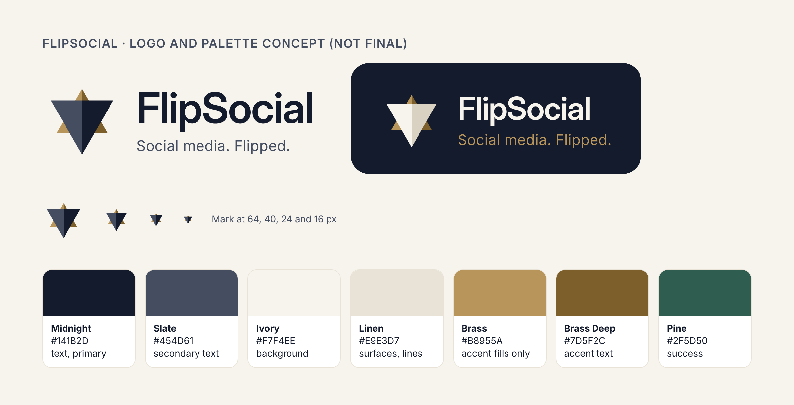

# FlipSocial private beta: migration plan

**Status:** approved in principle; not yet provisioned or implemented.
**Working name:** FlipSocial, until trademark and domain clearance is complete (section 2).
**Scope:** move the current localStorage prototype to a shared, invite only, multi user beta for about 5 to 10 creators and 30 to 50 fans, using Supabase (auth, Postgres, storage, server functions), Mux for video, and Vercel for the frontend.
**Unchanged:** the GitHub repository (`muyiwaomosa/crevant-prototype`) and the live Crevant demo (`crevant-prototype.vercel.app`).

Contents

1. Decisions log
2. Brand and naming (working name)
3. Current architecture and what can be reused
4. Environments: demo, staging, beta
5. Database schema
6. Authentication, profiles, invite only access
7. Posts, follows, feed, likes, comments
8. Video: Mux as the preferred service
9. Connection Points and rewards on the server
10. Advertising demonstration (illustrative only)
11. Security rules and abuse prevention
12. Moderation and safety
13. Media storage, privacy, account deletion
14. Implementation phases and acceptance tests
15. Costs
16. Risks, effort, deferred features
17. Open items that need your input
18. Sources
19. How this plan was produced

---

## 1. Decisions log

| # | Decision | Status |
| --- | --- | --- |
| D1 | Shared multi user app on Supabase; frontend stays on Vercel | Approved |
| D2 | Keep the unified experience: everyone can follow and create | Approved |
| D3 | Keep the chronological Following feed with no ranking | Approved |
| D4 | Keep creator specific Connection Points (CP), enforced on the server | Approved |
| D5 | Real, non monetary rewards with manual fulfilment; CP has no cash value | Approved |
| D6 | Creators can see participation and CP earned with them, with clear disclosure | Approved |
| D7 | 18+ only for the initial beta | Approved |
| D8 | Video upload and playback in scope; video watch CP deferred | Approved |
| D9 | Separate staging and beta environments, subject to cost and domain | Approved |
| D10 | Blocking is in scope for the beta | Approved |
| D11 | **FlipSocial** is the working name (tagline: Social media. Flipped.) until trademark and domain clearance; Crevant repo and demo unchanged | Approved |
| D12 | Fictional, clearly labelled ads; illustrative 50:50 split of **eligible attributed** revenue; never a payable balance | Approved |
| D13 | No automatic global hiding from report counts; personal hiding, prioritised queue, admin review, separate emergency escalation | Approved |
| D14 | No real payments, no algorithmic ranking, no unnecessary infrastructure | Approved |
| D15 | Mux is the preferred managed video service from launch, **subject to official pricing verification** | Approved, pending verification |
| D16 | Demo ad revenue is attributed only through **explicit creator sponsored campaigns**. General feed ad revenue is not allocated to creators; its allocation is a future business model decision | Approved |

---

## 2. Brand and naming (working name)

**Working name:** FlipSocial. **Tagline:** Social media. Flipped.

FlipSocial is a **working name** until trademark and domain clearance is complete. To keep a later name change cheap:

- The beta codebase keeps the product name, tagline, logo files, colours, and email sender in **one brand configuration file**. No page hardcodes the name.
- Vercel and Supabase project names can be renamed later; the domain is the only part that is expensive to change, so it is bought only after clearance (see the Phase 0 checklist).
- The Crevant repository and demo stay exactly as they are.

**Clearance checks still open:**

1. **Name already in use.** A web search found an existing "FlipSocial" social app for the Flipper Zero device (flipsocial.net). No trademark filing showed up, but that search is not a clearance.
2. **Association with "Flip".** A social shopping app called Flip (also known as "Flip Social Shopping") shut down in 2025 and was reported to have left creators with unpaid earnings. FlipSocial will show creator earnings, so consider how that association could land.
3. **Symbol.** A six pointed star of two triangles is a widely recognised religious and cultural symbol (the Star of David) and appears in other traditions. Get feedback from a diverse group before finalising.

**Logo concept** (`docs/brand/`, concept only): two pyramids forming a six pointed star. The **inverted pyramid** is full size, in front, and darkest, so it dominates; it stands for a creator economy where more people benefit. The upright pyramid is smaller, sits behind, and is brass. Each pyramid has a light and dark face. Files: `flipsocial-mark.svg`, `flipsocial-mark-dark.svg`, `flipsocial-concept.png`.

**Palette** (contrast against Ivory unless stated):

| Token | Hex | Use | Contrast |
| --- | --- | --- | --- |
| Midnight | `#141B2D` | Primary text, primary buttons, dark surfaces | 15.6:1 |
| Slate | `#454D61` | Secondary text | 7.7:1 |
| Ivory | `#F7F4EE` | Page background | n/a |
| Linen | `#E9E3D7` | Quiet surfaces, lines | n/a |
| Brass | `#B8955A` | Accent **fills only**; text only on Midnight | 2.6:1 on Ivory; 6.1:1 on Midnight |
| Brass Deep | `#7D5F2C` | Accent text on light backgrounds | 5.4:1 |
| Pine | `#2F5D50` | Success | 7.5:1 with white text |
| Garnet | `#9A2F2F` | Errors, destructive actions | 6.8:1 |

**Working environment names** (domain availability not yet checked):

| Thing | Working name |
| --- | --- |
| Domain | `flipsocial.app` preferred; alternatives `getflipsocial.com`, `flipsocial.co` (`flipsocial.net` is taken). Bought only after clearance |
| Beta URL | `beta.<domain>` |
| Staging URL | Vercel preview URLs |
| Vercel project | `flipsocial-beta` |
| Supabase projects | `flipsocial-beta` (Pro organisation), `flipsocial-staging` (Free organisation) |
| Mux environments | `flipsocial-staging`, `flipsocial-beta` |
| Sign in email sender | `no-reply@<domain>` |
| Demo | `crevant-prototype.vercel.app`, Crevant branded, untouched |

---

## 3. Current architecture and what can be reused

The current app (`main`, Release 2) is a React 19, TypeScript, Vite, Tailwind v4 single page app with React Router.

**localStorage dependencies:**

- All state lives in one React context (`src/state/store.tsx`), loaded from and saved to one localStorage key by `src/state/storage.ts`. That is the only file touching localStorage.
- Persisted: profile and picture, follows, likes, saves, comments, posts, created rewards, the CP ledger, redemptions, onboarding state.
- Seeded content: eight fictional accounts, their posts, comments, and rewards (`src/data/seed.ts`), plus simulated numbers (`src/lib/simulate.ts`, `SELF_FOLLOWER_TREND`, base follower counts).
- Images are stored as compressed JPEG data URLs inside localStorage.
- A single hardcoded user, `SELF_ID = 'me'`, appears 33 times in 11 files.
- All CP rules run in the browser (`src/lib/points.ts`). They are pure and tested, but tamperable.

**Reuse:**

| Area | Verdict |
| --- | --- |
| `ui.tsx`, `Modal` (with focus trap), `Tabs`, `Avatar`, `Toasts`, `Layout`, Tailwind tokens | Reuse; restyle from the brand configuration |
| `Wordmark` | Replace with a component that reads the brand configuration |
| `PostCard`, `CreatorCard`, `RewardCard`, `AvatarEditor` | Reuse with small changes: data from query hooks, media from storage or Mux |
| Pages: Home, Discover, Create, Rewards, Profile, Post, Creator, Onboarding, Creator tools | Keep layouts; swap `useStore()` for query hooks; add loading, error, and empty states |
| `lib/time.ts`, `lib/format.ts` | Reuse |
| `lib/commentQuality.ts`, `lib/watch.ts` | Keep as client side hints only; the server decides |
| `lib/points.ts`, `lib/wallets.ts` and tests | Become the specification; rules move to Postgres; shared test cases check both |
| `lib/avatar.ts`, `lib/image.ts` | Reuse resizing; output a Blob for upload; canvas re encoding strips location metadata |
| `state/store.tsx`, `state/storage.ts` | Replace with a data layer: `@supabase/supabase-js` plus `@tanstack/react-query` |
| `lib/simulate.ts`, simulated counts and trends | Remove from the beta; every organic number must be real |
| `data/seed.ts` | Becomes a staging only seed script |
| `e2e/*.cjs` | Adapt to run against staging with test accounts |

New client libraries: `@supabase/supabase-js`, `@tanstack/react-query`, and Mux's upload and player components (`@mux/upchunk` and `@mux/mux-player-react`), or the plain HTML video element with HLS support where the browser lacks it natively.

---

## 4. Environments: demo, staging, beta

| Environment | Frontend | Backend | Video | Data | Purpose |
| --- | --- | --- | --- | --- | --- |
| Demo | Existing Vercel project, `crevant-prototype.vercel.app`, built from a frozen `demo` branch | None (localStorage) | Bundled sample files | Fictional seed | Public walkthrough; unchanged |
| Staging | `flipsocial-beta` Vercel project, preview deployments | Supabase `flipsocial-staging` (Free) | Mux staging environment | Seeded test accounts; safe to wipe | Testing every change |
| Beta | `flipsocial-beta` Vercel project, production deployment on `beta.<domain>` | Supabase `flipsocial-beta` (Pro) | Mux production environment | Real members only | The private beta |

- The demo is frozen, not kept in sync. **Before any beta code merges to `main`, the demo's Vercel project must be pointed at a frozen `demo` branch**, or the demo would change with the next merge (Phase 0 checklist).
- Database changes are versioned SQL files in `supabase/migrations`, applied to staging first, then to beta.
- Each environment has its own Supabase URL and publishable key, and its own Mux credentials. Secret keys (Supabase service key, Mux token and signing key, webhook secrets) live only in Supabase server function secrets, never in the frontend or in Vercel's browser visible variables.
- No demo data moves to the beta.

---

## 5. Database schema

All tables have `created_at`. IDs are UUIDs; a person's ID is their Supabase Auth user ID.

| Table | Key columns | Notes |
| --- | --- | --- |
| `profiles` | `id`, `handle` (unique, case insensitive), `display_name`, `bio`, `category`, `avatar_path`, `onboarding_status`, `is_admin`, `suspended_at`, `beta_cohort`, `deletion_requested_at`, `sponsorship_opt_in_at` | One profile per person; no fan or creator role. `beta_cohort` is a research label, never shown |
| `guideline_acceptances` | `user_id`, `guidelines_version`, `age_confirmed`, `accepted_at` | Recorded during onboarding |
| `follows` | `follower_id`, `followee_id` | Primary key on the pair; no self follows |
| `blocks` | `blocker_id`, `blocked_id` | Primary key on the pair; no self blocks |
| `posts` | `id`, `author_id`, `body` (max 500), `media_type` (none, image, video), `image_path`, `video_provider` (mux, supabase), `mux_upload_id`, `mux_asset_id`, `mux_playback_id`, `video_path`, `poster_path`, `duration_seconds`, `media_status` (ready, processing, failed), `likes_count`, `comments_count`, `hidden_at` | Index on (`author_id`, `created_at` desc). `video_provider` keeps the Supabase fallback possible |
| `post_likes` | `user_id`, `post_id` | Primary key on the pair |
| `post_saves` | `user_id`, `post_id` | Private to the saver |
| `comments` | `id`, `post_id`, `author_id`, `body` (max 400), `hidden_at` | |
| `rewards` | `id`, `owner_id`, `title`, `description`, `fulfilment_info`, `cost` (5 to 1,000), `kind`, `stock`, `redeemed_count`, `active` | Anyone can offer rewards |
| `cp_rules` | `action`, `points`, `daily_limit` | Tunable without a release |
| `cp_wallets` | `fan_id`, `creator_id`, `balance` (>= 0), `owed` (>= 0), `lifetime_earned`, `frozen` | One row per relationship |
| `cp_ledger` | `id`, `fan_id`, `creator_id`, `kind`, `amount`, `ref_id` | Append only; unique on (`fan_id`, `kind`, `ref_id`) for once per item grants |
| `cp_follow_bonus` | `fan_id`, `creator_id`, `granted_at` | Bonus held while following |
| `redemptions` | `id`, `reward_id`, `fan_id`, `creator_id`, `cost`, `code`, `status` (pending, fulfilled, declined, cancelled), `fan_note`, `fulfilment_note`, `idempotency_key`, `reward_title_snapshot`, `fulfilled_at` | Unique on (`reward_id`, `fan_id`) |
| `reports` | `id`, `reporter_id`, `target_type`, `target_id`, `category`, `severity`, `note`, `status`, `assigned_to` | |
| `moderation_actions` | `id`, `admin_id`, `action`, `target_type`, `target_id`, `reason`, `report_id` | Audit log; never edited |
| `moderation_notices` | `id`, `user_id`, `message`, `read_at` | What an affected person sees |
| `evidence_holds` | `id`, `target_type`, `target_id`, `snapshot`, `storage_path`, `expires_at` | Admins only |
| `app_settings` | `video_uploads_enabled`, `video_daily_limit`, `video_monthly_limit`, `ads_enabled` | Kill switches and caps |
| `demo_campaigns` | `id`, `campaign_type` (creator_sponsored, general), `advertiser_name`, `headline`, `body`, `image_path`, `partner_creator_id` (required for creator_sponsored, null for general), `partner_consent_at`, `active` | Fictional campaigns; admin managed |
| `ad_settings` | `slot_interval`, `illustrative_cpm_usd`, `creator_share` | Demo assumptions in one place |
| `ad_impressions` | `viewer_id`, `campaign_id`, `slot_index`, `attributed_creator_id`, `day` | Unique on (`viewer_id`, `campaign_id`, `day`). `attributed_creator_id` is copied from the campaign, never from the feed. Viewer rows deleted after 30 days |
| `ad_daily_totals` | `campaign_id`, `attributed_creator_id`, `day`, `impressions` | Aggregates kept after viewer rows are purged |
| `deletion_log` | `id`, `hashed_user_id`, `requested_at`, `completed_at`, `counts`, `cleanup_status` | Non identifying record that a deletion ran |

---

## 6. Authentication, profiles, invite only access

- **Sign in:** email one time code, sent both as a 6 digit code and a magic link. The code works inside Instagram and TikTok in app browsers.
- **Invite only:** public sign ups are turned off in Supabase Auth. Admins invite members from the Supabase dashboard or a small local admin script. Unknown emails cannot sign in.
- **Profiles:** created by a database trigger on first sign in. Onboarding collects display name and handle (unique), confirms **18+**, and records acceptance of the community guidelines and the supporter visibility disclosure (D6).
- **Supporter disclosure:** "When you engage with someone's posts, they can see that you support them and how many CP you've earned with them."
- **Rollout:** invite creators about a week before fans, and stagger invites over several days (section 15, email limit).
- **Email:** a sending service (Resend or Postmark) through Supabase custom SMTP, on the cleared domain.

---

## 7. Posts, follows, feed, likes, comments

- **Following feed:** posts from people you follow plus your own, strictly newest first, 20 at a time with keyset paging on (`created_at`, `id`). No ranking. Day dividers and "all caught up" carry over. Demo ads are inserted by a fixed slot rule that never changes organic order (section 10).
- **Visibility:** everything is visible only to signed in members, minus anything hidden or involving a block (section 12). Nothing is public.
- **Engagement through server functions:** following, liking, saving, and commenting go through database functions (`follow_user`, `like_post`, `save_post`, `add_comment`, and their reverses). Each writes the action and any CP in one transaction and returns an outcome, keeping the existing feedback messages. Publishing is a direct insert protected by security rules.
- **Discover:** real members A to Z, search by name or handle, excluding blocked accounts.
- **No realtime infrastructure:** the feed refreshes on open, pull to refresh, and tab focus.

---

## 8. Video: Mux as the preferred service

**Recommendation (D15):** use Mux for all video from launch, **subject to verifying pricing on Mux's official pricing page** before signing up. Images stay on Supabase Storage.

### Why Mux: the evidence

On 5 November 2026, test files were generated and played in headless Chromium 153 (no hardware decoding):

| File | Codec | Result |
| --- | --- | --- |
| `h264.mp4` | H.264 | Decoded and played |
| `h264.mov` | H.264 in QuickTime | Decoded and played |
| `hevc.mp4` | HEVC (H.265) | Failed to decode |
| `hevc.mov` | HEVC in QuickTime | Failed to decode |
| `vp9.webm` | VP9 | Decoded and played |

The container is not the problem; the **codec** is. iPhones record HEVC by default. Apple devices play it; many Android phones and desktop browsers cannot be relied on to. Serving phone uploads directly would leave some members with videos that do not play. This was one engine, not real devices; the Phase 2 device gate still tests real hardware.

### Mux compared with direct Supabase delivery

| | Mux (preferred) | Direct from Supabase Storage |
| --- | --- | --- |
| iPhone HEVC uploads | Converted to H.264 streams that play everywhere | Would fail for some viewers; needs an H.264 only upload gate and asking iPhone users to change camera settings |
| Playback on weak connections | Adaptive streaming picks the right quality, so playback starts faster and buffers less | One fixed file at full upload size |
| Bandwidth | Streams smaller renditions to phones; delivery billed by minutes watched | Full size file downloaded; billed by GB beyond the Pro allowance |
| Posters and thumbnails | Generated automatically | Captured in the browser and uploaded separately |
| Large uploads | Direct, resumable browser uploads to Mux; no 50 MB storage file limit to manage | Resumable uploads needed for large files; Supabase file size limits apply |
| Privacy | Signed playback IDs with short expiry | Signed storage URLs with short expiry |
| Time to playable | Seconds to a few minutes of processing after upload (`media_status = processing`) | Immediate |
| Moving parts | A second vendor and account; two server functions (create upload URL, receive the "asset ready" webhook); a signing key for playback; deletion must call the Mux API | None beyond Supabase |
| Lock in | Video assets live at Mux; originals can be retained or downloaded if we leave (check plan terms) | Everything in one place |
| Privacy notice | Mux becomes a data processor that must be listed | No new processor |
| Cost at beta scale (section 15) | About $0 to $9 a month across all scenarios, if published rates hold | $0 at expected use; about $21 heavy; about $200 in a stress month |

**Trade offs accepted:** one more vendor, two small server functions, a short processing delay, and a dependency on Mux's pricing and terms. In return, every member can play every video, playback is faster on phones, and bandwidth costs are far more predictable.

### How video works with Mux

1. The member picks a video. The browser checks type, size (up to 200 MB raw from the phone) and length (up to 60 seconds) before anything uploads.
2. A server function (`create-video-upload`) checks that the member is allowed to upload, has not hit the daily or monthly video cap, and that `video_uploads_enabled` is on. It creates a Mux direct upload limited to 1080p and the basic quality tier, and returns a one time upload URL.
3. The browser uploads straight to Mux (resumable). A draft post is created with `media_status = processing`.
4. Mux sends a signed webhook to a second server function (`mux-webhook`). It verifies the signature, then stores the asset and playback IDs and marks the post `ready`. If processing fails, the post is marked `failed` and the author is told.
5. Viewers get a short lived signed playback token from a server function. Video plays on tap, never autoplays with sound, and loads nothing until tapped.
6. No video watch CP (D8). Videos still earn like, save, and comment CP.

### Cost controls

- **Caps on input:** 60 seconds; 1080p maximum resolution; basic quality tier (free encoding, if published rates hold).
- **Caps on volume:** per member, 5 video uploads a day and 30 a month (tunable in `app_settings`); tighter in an account's first 48 hours.
- **Caps on delivery:** tap to play, no autoplay, no preloading, signed playback with short expiry, so links cannot be hotlinked.
- **Kill switch:** `video_uploads_enabled` can be turned off instantly without a release; existing videos keep playing.
- **Clean up:** deleted posts and deleted accounts delete their Mux assets; a weekly reconcile script removes any orphaned asset.
- **Watching the bill:** set any usage or billing alerts Mux offers (check what is available on the chosen plan), review usage weekly during the beta, and set Supabase's spend cap and Vercel's spend management.
- **Staging hygiene:** a separate Mux environment for staging, with test assets deleted regularly.

### If official pricing does not hold up

If Mux's official pricing turns out materially higher than the published rates used here, fall back to direct Supabase delivery: H.264 only upload gate (the browser reads the file header for the HEVC tag), instructions for iPhone users to record in "Most Compatible", 50 MB and 60 second limits, resumable uploads, and the same caps and kill switch. The `video_provider` column keeps this switch contained to the upload and playback components.

---

## 9. Connection Points and rewards on the server

- All CP writes happen inside database functions. Clients read their own wallets and ledger and never write to them.
- Rules carried over from Release 1:
  - Values and daily limits from `cp_rules`.
  - Once per item, enforced by the ledger's unique constraint.
  - Nobody earns from their own content.
  - The follow bonus is held while following and reversed on unfollow, with any shortfall recorded as owed.
  - Comment quality checks are ported to SQL.
- The TypeScript comment checks stay in the browser for the live hint. One shared file of test cases runs against both.
- Daily limits reset at midnight UTC; the UI shows the local reset time.
- **No watch CP** (D8).
- **Redemption:** one function locks the fan's wallet and the reward, re checks following, balance with that creator, stock, block status, and prior redemption, then deducts and records. A client generated idempotency key makes retries and double taps safe.
- **Real fulfilment (D5):**
  - Each reward states "How you'll receive this".
  - The fan may add a note at redemption (max 280 characters, with a warning not to share sensitive details).
  - The creator marks it fulfilled with a delivery note, or declines, which refunds the CP in the same transaction.
  - Guidelines ban cash and cash equivalents as rewards. CP can never be bought, sold, transferred, or exchanged for money.
- **Supporters list (D6):** creators see people who earned CP with them, ranked by lifetime CP, excluding anyone in a block relationship.

---

## 10. Advertising demonstration (illustrative only)

**Purpose:** show how FlipSocial's proposed 50:50 split of eligible, attributed advertising revenue could look for creators. There are no real advertisers, no billing, no revenue, and no payouts.

### Two kinds of fictional campaign

| | Creator sponsored campaign | General demo ad |
| --- | --- | --- |
| What it is | A fictional brand sponsoring a specific beta creator who has agreed to take part | A fictional brand with no creator partner |
| Label | **"Paid partnership with @handle · Demo campaign, not a real advertiser"** | **"Sponsored · Demo ad, not a real advertiser"** |
| Attribution | **Explicit:** every impression is attributed to the campaign's named partner creator, set by an admin with the creator's recorded consent | **None.** Not attributed to any creator |
| Illustrative earnings | Counted as eligible attributed revenue; split 50:50 in the illustration | Not allocated to creators. How general feed revenue should be shared is a **future business model decision** |

Attribution never depends on where an ad appears or which post sits next to it.

### Creator participation

- Creators opt in to demo sponsorships from Creator tools (`profiles.sponsorship_opt_in_at`). An admin then attaches one or more fictional campaigns to them (`partner_consent_at` on each campaign).
- Creators can opt out at any time; their campaigns are deactivated and stop showing.
- Brand names, logos, and products are invented. No real companies.

### Placement (organic order never changes)

- One ad slot after every 6th organic post in the Following feed (`ad_settings.slot_interval`), counting organic posts only.
- Never first, never two in a row, and no ads in feeds with fewer than 6 posts.
- Ads appear only in the Following feed.
- Campaigns rotate in a fixed order. There is no targeting and no use of personal data.
- A creator sponsored campaign is not shown to its own partner creator, or to anyone in a block relationship with the partner.
- **Invariant, tested:** removing every ad from a rendered feed gives exactly the same organic posts in the same order as the plain chronological query.

### Attribution and the illustrative calculation

1. An **impression** is an ad at least 50% visible for at least 1 continuous second, counted once per viewer, per campaign, per UTC day.
2. An impression of a **creator sponsored campaign** is attributed to that campaign's partner creator. An impression of a **general demo ad** is attributed to nobody.
3. **Eligible attributed revenue (illustrative)** = attributed impressions × an assumed CPM ÷ 1,000. The demo assumes **$5 CPM**, a round figure that is not a market estimate, stored in `ad_settings` and shown on the dashboard.
4. **Illustrative split:** 50% creator, 50% platform.
5. General demo ad impressions are counted for admins only. Creators see no share of them, and the dashboard explains that general revenue allocation has not been decided.

### Illustrative earnings dashboard

Location: Profile, then Creator tools, then "Sponsorships (illustrative)". Visible only to creators with at least one campaign.

- A persistent banner: **"Illustrative only. These are not real earnings, no advertiser has paid, and nothing here is payable."**
- Per campaign: the fictional brand, attributed impressions by day, illustrative eligible revenue, illustrative creator 50%, illustrative platform 50%, and the assumptions in plain words.
- A short note: "Revenue from general ads in the feed isn't shared in this model yet. How it should be shared is still being decided."
- Figures are labelled "illustrative $" and are never shown as a balance, wallet, or withdrawable amount. There is no withdraw or payout control anywhere.

### Privacy

Recording impressions means recording that a member saw an ad. Viewer level rows are deleted after 30 days; only daily totals per campaign remain. The privacy notice says so.

### Not included

Real advertisers, billing, invoicing, payouts, tax handling, targeting, third party ad networks, tracking pixels, and any allocation of general feed revenue.

---

## 11. Security rules and abuse prevention

Row level security is on for every table.

| Table | Read | Write |
| --- | --- | --- |
| `profiles` | Members, minus blocks | Owner, except admin, suspension, cohort fields |
| `posts`, `comments` | Members, minus hidden and blocks; authors see their own | Authors insert and delete their own; post authors can delete comments on their posts |
| `post_likes`, `follows` | Own rows | Engagement functions only |
| `post_saves` | Owner | Owner, through functions |
| `blocks` | Blocker | `block_user`, `unblock_user` |
| `cp_wallets`, `cp_ledger` | The fan; the creator for their own supporters | Never by clients |
| `rewards` | Members, minus blocks | Owner, within constraints |
| `redemptions` | Fan and reward owner | Owner updates status and note through functions |
| `reports` | Reporter (own) and admins | Members insert; admins update |
| `demo_campaigns` | Members (active only) | Admins |
| `ad_impressions`, `ad_daily_totals` | Partner creator for their own campaigns; admins | `record_ad_impression` only |
| `moderation_*`, `evidence_holds`, `ad_settings`, `app_settings` | Admins (settings readable by members) | Admins |

All server functions:

- set a fixed search path;
- check the caller and refuse anyone signed out or suspended;
- call `is_blocked_between(a, b)` where relevant.

The Mux webhook function verifies Mux's signature before doing anything. Supabase's security advisor runs before every release.

**Abuse limits:**

- Daily caps: 20 posts, 100 comments, 50 follows, plus the video caps in section 8.
- Tighter caps in an account's first 48 hours.
- Text length limits; no self follow or self engagement.
- Suspended accounts can read their own data and delete their account, but cannot act.
- Invite only entry is the main defence against fake accounts.
- An admin query flags pairs of accounts inflating each other's CP.

---

## 12. Moderation and safety

### Blocking

Anyone can block anyone from a profile, post, or comment. Blocking is mutual in effect and silent.

When A blocks B:

- Follows in both directions are removed. Normal follow bonus reversal applies.
- Neither sees the other's posts, profile, comments, rewards, sponsored campaigns, or supporter entries. Each sees "This account isn't available".
- B's comments on A's posts are hidden from everyone; A's comments on B's posts are hidden from B.
- B cannot follow, like, save, comment on, or redeem anything of A's. The server functions refuse it.
- B's CP with A is frozen, not deleted. B's pending redemptions of A's rewards are cancelled and refunded into the frozen wallet.
- Unblocking restores visibility and unfreezes the CP; it does not restore follows.

### Creators control their space

Authors can delete any comment on their own posts. CP already earned from that comment stays.

### Reporting

| Severity | Categories |
| --- | --- |
| Emergency | Child sexual exploitation; credible threat of violence; self harm or suicide risk; non consensual intimate imagery; doxxing |
| High | Harassment or bullying; hate; sexual content; graphic violence; impersonation |
| Standard | Spam; intellectual property; misleading reward; other |

- **Immediate personal hiding:** the reporter stops seeing the reported item at once and is offered the option to block.
- **No automatic global hiding** based on report counts (D13). Content stays visible to others until an admin acts.

### Prioritised moderation queue

- A `moderation_queue` view in the Supabase dashboard, ordered by:
  1. severity;
  2. number of distinct reporters;
  3. age of the oldest report.
- Admin functions hide or restore content, suspend or unsuspend accounts, place evidence holds, resolve reports, and send in app notices.
- Every action is written to `moderation_actions`.

| Severity | First look | Notes |
| --- | --- | --- |
| Emergency | Within 1 hour while moderators are awake; immediately on waking otherwise | Follow the escalation process below |
| High | Within 12 hours | |
| Standard | Within 48 hours | |

### Emergency escalation process

1. **Alert.** An Emergency report sends an immediate email to every on call moderator.
2. **Contain.** The moderator hides the content for everyone and, where warranted, suspends the account. Both are logged.
3. **Preserve.** An evidence hold copies the content and metadata into a restricted admin only store. It survives account deletion for a fixed period (proposed 90 days, subject to legal advice).
4. **Specific cases:**
   - **Child sexual exploitation:** do not download, forward, or screenshot the material. Follow the legal process agreed in advance with counsel; in the United States this includes reporting to NCMEC.
   - **Self harm or suicide risk:** send the person an in app notice with crisis resources for their country. If there is an imminent risk to life and you have identifying information, contact emergency services.
   - **Credible threats:** preserve evidence; contact law enforcement where appropriate.
   - **Non consensual intimate imagery and doxxing:** remove first, review second.
5. **Follow up.** Tell the reporter action was taken, without details. Record an incident note. Review the process after each emergency.

Legal duties vary by country. **This plan is not legal advice**; the process must be agreed with counsel before launch.

### Prevention and transparency

- Community guidelines accepted at onboarding (version stored), including the no cash rewards rule and the illustrative ads explanation.
- In app notices tell people when content is removed or an account is suspended, with an appeals email.
- **Deferred:** muting, keyword filters, restricting who can comment, automated scanning of images and video, in app appeals.

---

## 13. Media storage, privacy, account deletion

### Storage

- **Supabase private buckets:** `avatars` (2 MB, images), `post-images` (5 MB, images), `evidence` (admins only), and `post-videos` (only used if the Supabase video fallback is active).
- Objects are stored under the owner's user ID folder. Bucket settings enforce types and sizes. Media is served through short lived signed URLs, fetched in batches.
- **Video on Mux** uses signed playback with short expiry and never sits in Supabase Storage.
- Browser side resizing strips location metadata from images.

### Account deletion (consistent procedure)

Started by the member from Profile, after a fresh one time code (sign in within the last 10 minutes). A server function, `delete-account`, runs these steps. Each is idempotent, so a retry finishes the job.

1. **Mark** `profiles.deletion_requested_at`, sign the person out everywhere, and stop all actions from the account.
2. **Evidence check.** Items under an open Emergency report are already in an evidence hold and are kept until the hold expires.
3. **One database transaction** (`delete_account_data`):
   - **Redemptions where they are the fan:** pending ones are cancelled; their redemption rows are deleted; rewards' `redeemed_count` and stock are recalculated.
   - **Redemptions of their rewards by others:** pending ones are cancelled. Those fans keep a history entry showing the reward title snapshot and "Account deleted". The creator's wallets are deleted, so no refund is owed.
   - **CP:** all wallets, ledger rows, and follow bonuses where they are the fan or the creator are deleted. The deletion explainer tells members that CP with a deleted account disappears.
   - **Social:** their posts, comments, likes, saves, follows, and blocks are deleted. Counts on other people's posts are recalculated by the same triggers.
   - **Ads:** their impression rows are deleted. Campaigns where they are the partner are deactivated, and that campaign's impressions and totals are deleted.
   - **Moderation:** reports they filed are kept with the reporter removed. Reports about them and `moderation_actions` are kept with the target anonymised.
   - **Record** a `deletion_log` row with a hashed ID, counts, and timestamps.
4. **Media:** delete every object under their folder in Supabase Storage, and every Mux asset linked to their posts through the Mux API. Failures are recorded on the `deletion_log` row and retried.
5. **Delete the Auth user.**
6. **Reconcile:** a weekly admin script lists storage objects and Mux assets with no matching post or profile, and deletes them.

**Before confirming, the member is told:** what is deleted; that comments on others' posts disappear; that CP and pending redemptions are cancelled; that it is permanent; and that some safety records may be kept for a limited time where required.

### Privacy notice (to be written with counsel)

It covers:

- what is stored, including ad impression records;
- who can see what, including supporters' CP visibility;
- processors: Supabase, Vercel, Mux, the email provider;
- retention: 30 days for viewer level ad data, the evidence hold period;
- deletion; the 18+ requirement; contact details.

Data export is manual, on request, during the beta.

---

## 14. Implementation phases and acceptance tests

**Phase 0: setup.** Mostly founder tasks, in the order given in section 17. Engineering: freeze the demo branch, add `supabase/migrations`, database test tooling, CI on pull requests, and the brand configuration file.

- Accept:
  - the demo URL serves the unchanged Crevant demo from the `demo` branch;
  - migrations apply to an empty project;
  - previews point at staging;
  - no secret in the built frontend;
  - CI runs tests on every pull request.

**Phase 1: accounts, profiles, brand.** Invite only sign in, profile creation, onboarding (18+, guidelines, supporter disclosure), profile and picture uploads, sign out, working name branding from the configuration file.

- Accept:
  - an invited email signs in; an uninvited one cannot;
  - handles are unique regardless of case;
  - a database test proves one member cannot edit another's profile;
  - a 10 MB or PDF image upload is rejected by storage itself;
  - changing the brand configuration renames the product everywhere in one place.

**Phase 2: social core and video.** Posts with images and Mux video, follows, Following feed, likes, saves, comments, Discover, author comment deletion.

- Accept:
  - posts appear in followers' feeds newest first with correct paging, no duplicates or gaps;
  - saves are private; deleted posts vanish everywhere and their Mux assets are deleted;
  - over 60 seconds is rejected; the daily and monthly video caps hold; the kill switch stops new uploads while existing videos keep playing;
  - a forged webhook without a valid signature changes nothing;
  - a video stuck in processing shows a clear state, and a failed one tells the author;
  - **device gate:** HEVC and H.264 videos uploaded from an iPhone, an Android phone, and a desktop all play on iPhone Safari, Android Chrome, and desktop Chrome, Safari, Firefox, and Edge.

**Phase 3: CP, rewards, fulfilment.**

- Accept:
  - every Release 1 rule passes as a database test;
  - shared comment test cases pass on client and server;
  - 20 simultaneous redeem calls produce one redemption and one deduction;
  - a browser insert into wallets or the ledger is refused;
  - mutual followers earn independently;
  - decline refunds exactly the cost;
  - fan notes are visible only to the fan and the creator.

**Phase 4: moderation, safety, deletion.**

- Accept:
  - **block:** after A blocks B, B's content is gone from all of A's screens and B's comments vanish from A's posts for everyone; B cannot act on A's content even by calling the functions directly; B's pending redemption is refunded and the wallet frozen; unblocking restores it;
  - **report:** a reported item disappears for the reporter only; ten reports alone do not hide it for anyone else; an admin hide does;
  - **emergency:** an Emergency report sends an alert email within a minute; an evidence hold survives the subject's account deletion;
  - **audit:** every admin action is in the audit log;
  - **suspension:** a suspended account cannot post but can delete itself;
  - **deletion:** removes every row listed in section 13; counts on others' posts are corrected; storage objects and Mux assets are removed; the reconcile script finds nothing left behind.

**Phase 5: illustrative sponsorships.** Creator opt in, fictional campaigns, placement, impressions, dashboard.

- Accept:
  - **ordering invariant:** the organic order with ads removed equals the chronological query, across 500 generated feed pages;
  - **placement:** no ad first, no two adjacent, none in short feeds;
  - **attribution:**
    - a creator sponsored campaign attributes every impression to its named partner, wherever it appears and whatever post is next to it;
    - a general demo ad produces no creator attribution and no creator earnings;
    - a partner never sees their own campaign; blocked viewers never see it;
  - **consent:** a campaign cannot be activated without both the creator's opt in and a consent timestamp; opting out stops it immediately;
  - **dashboard maths:** attributed impressions × CPM ÷ 1,000 × 50%;
  - **labels:** every ad and every dashboard figure carries an illustrative label; there is no payout or withdraw control anywhere.

**Phase 6: beta readiness.** Remove all simulated organic numbers, error and empty states, backups confirmed and one restore tested, a team dry run on staging, then invite creators, then fans.

- Accept: all suites green on staging; no console errors; 320 px layouts clean; go or no go checklist signed off.

---

## 15. Costs

**Pricing has not been verified on the vendors' own pages.** Figures come from third party pricing guides from late 2026 and from search summaries of Cloudflare's and Mux's documentation. Mux's adoption depends on verifying its official pricing (D15).

### Base monthly cost

| Item | Choice | Approx. per month |
| --- | --- | --- |
| Supabase beta | Pro: about $25, including about $10 compute credit (one Micro database), about 100 GB file storage, about 250 GB uncached egress | ~$25 |
| Supabase staging | Free plan in a separate organisation (pauses after a week idle, fine for staging) | $0 |
| Vercel | Pro, because Hobby is personal and non commercial only; about $20 with one deploying seat | ~$20 |
| Mux | Pay as you go; basic encoding free, first 100,000 delivered minutes free, storage about $0.003 per minute per month at 1080p. Check plan minimums and any asset caps | ~$0 to $9 (see scenarios) |
| Email | Resend free: 3,000 a month, **100 a day** | $0 |
| Domain | Bought after clearance, billed yearly | ~$1 to $2 |
| Error monitoring (optional) | A free tier, or Vercel and Supabase logs | $0 |
| **Base total** | | **about $45 to $59**, depending on video use |

**Email daily limit:** 60 invitations plus 60 first sign ins on one day would exceed 100. Stagger invites over 2 to 3 days, or use Resend's paid tier (about $20 a month) for launch week.

### Video scenarios

Assumptions: average video 30 seconds and about 25 MB as uploaded; about 60 members.

| Scenario | Videos a month | Plays per video | Share watched | Mux (preferred) | Direct from Supabase (fallback) | Cloudflare Stream (reference) |
| --- | --- | --- | --- | --- | --- | --- |
| Light | 40 | 25 | 60% | under $1 | $0 | ~$5 |
| Expected | 150 | 40 | 70% | ~$1 | $0 | ~$7 |
| Heavy | 400 | 60 | 80% | ~$4 | ~$21 | ~$20 |
| Stress | 1,000 | 100 | 100% | ~$9 | ~$202 | ~$65 |

- **Mux** stays inside its 100,000 free delivered minutes in every scenario; its cost here is storage, accumulated over six months. The per member caps (5 a day, 30 a month) bound uploads, and the kill switch bounds anything unexpected.
- **Supabase** is egress over the included ~250 GB at ~$0.09 per GB.
- **Cloudflare Stream** ($5 per 1,000 minutes stored, $1 per 1,000 delivered) is shown only for reference.

### Totals

| Path | Expected month | Heavy month | Stress month |
| --- | --- | --- | --- |
| Mux (preferred) | ~$46 to $51 | ~$49 to $54 | ~$54 to $59 |
| Direct from Supabase | ~$45 to $50 | ~$66 to $71 | ~$247 to $252 |

---

## 16. Risks, effort, deferred features

### Risks

| Risk | Mitigation |
| --- | --- |
| A security rule mistake leaks private data | Database tests for every table from three viewpoints: owner, other member, signed out |
| Mux pricing or terms differ from published figures | Verify before signing up; the Supabase fallback is designed and contained behind `video_provider` |
| A second vendor fails or changes terms | Asset IDs stored, originals retrievable (check terms), fallback path ready |
| Video processing delay confuses creators | Clear "processing" state and failure messages; Phase 2 tests |
| Illustrative earnings mistaken for real money | Persistent labels; no balance or payout UI; guidelines; onboarding explanation; research questions |
| Creators read general ads as "money they're owed" | General ads explicitly unallocated with an on screen explanation; only consented, named sponsorships show illustrative earnings |
| Working name not cleared | Brand configuration file keeps a rename cheap; domain bought only after clearance |
| Brand: "Flip" association, symbol perception | Diverse feedback before finalising |
| Client and server CP rules drift | Shared test cases |
| Sign in emails go to spam | Own domain with email authentication; test with Gmail and Outlook first |
| Empty feeds at launch | Invite creators first |
| No notifications, so people do not return | Measure in the beta; weekly digest is the first candidate afterwards |
| A moderator is unavailable during an emergency | At least two named on call moderators; documented process |
| Supporter visibility feels invasive | Disclosure at onboarding; research question |
| Scope creep | Hold the deferred list |

### Effort

| Work | Sessions |
| --- | --- |
| Phase 1 | 1 to 2 |
| Phase 2 (including Mux) | 3 to 4 |
| Phase 3 | 2 |
| Phase 4 | 2 to 3 |
| Phase 5 (sponsorships) | 1 to 2 |
| Phase 6 | 1 |
| **Total** | **about 10 to 14 working sessions** |

Realistic elapsed time is **about 4 to 6 weeks**, driven by clearance, founder setup tasks, legal texts, the moderator roster, review rounds, and real device testing.

### Deferred

- Payments of any kind, real ad billing, creator payouts, and **allocation of general feed ad revenue**.
- Algorithmic ranking or "for you" feeds; ad targeting.
- Realtime feeds; push and email notifications other than sign in and moderator alerts.
- Video watch CP; direct messages; native apps; public profiles and search indexing.
- Muting; keyword filters; automated content scanning; in app appeals; self serve data export.
- Editing posts; multiple media per post; a hybrid points model.
- An admin interface beyond the Supabase dashboard.

---

## 17. Open items that need your input

1. Trademark and domain clearance for the working name, then domain choice.
2. Logo concept feedback, including the symbol perception point in section 2.
3. Official pricing checks for Supabase, Vercel, Mux, and the email provider (D15).
4. Accounts created by you: Supabase beta (Pro) and staging (Free); Vercel (Pro); Mux; email provider.
5. Moderation roster: at least two named moderators, on call hours, and an appeals contact email.
6. Legal: privacy notice, terms, community guidelines, and the emergency process reviewed by counsel.
7. Which beta creators will opt in to demo sponsorships, and which fictional campaigns to create for them.
8. **Future business model decision:** how, if at all, general feed advertising revenue should be shared with creators.

### Phase 0 setup checklist, in order

Phases 1 to 5 can be built and tested entirely on **staging**. The paid beta project, the domain, and email sending are only needed before launch, so clearance and legal work can run in parallel with development, and paid costs start later.

**Start now (long lead times, run in parallel):**

1. Approve the plan on PR #4.
2. Start trademark and domain clearance for the working name.
3. Brief counsel on the privacy notice, terms, community guidelines, and emergency process. Claude can draft first versions for them to review.
4. Name at least two moderators, their on call hours, and an appeals email address.
5. Verify official pricing for Supabase, Vercel, Mux, and the email provider, and confirm Mux.

**Before any engineering merges (protects the demo):**

6. Freeze the demo. Claude creates a `demo` branch from the current `main`; you set the existing Crevant Vercel project's production branch to `demo`.

**Staging accounts (unblocks Phases 0 to 5):**

7. Create a free Supabase organisation and the `flipsocial-staging` project.
8. Create a Mux account and a staging environment.
9. Create a Vercel Pro team and a new `flipsocial-beta` project linked to this repository (preview deployments only for now).
10. Send Claude the non secret identifiers (project URLs, environment names). Secrets go only through the secure credential form Claude will open. Then tell Claude to start Phase 0 engineering.

Staging can send its few test sign in emails through Supabase's built in sender; the custom email service is only needed for beta.

**Before launch (after clearance):**

11. Buy the cleared domain.
12. Create the email provider account, add the domain, and add the email authentication DNS records it gives you (SPF, DKIM, DMARC).
13. Create the Supabase Pro organisation and `flipsocial-beta` project; set the spend cap. Create the Mux beta environment.
14. Point `beta.<domain>` at the Vercel project. Claude will give you the exact Supabase Auth settings: sign ups off, custom email, site and redirect URLs.
15. Finalise the legal texts, brief the moderators on the queue and emergency process, and pick the creators for the first invite wave.

---

## 18. Sources

- [Supabase pricing (official)](https://supabase.com/pricing)
- [Supabase Pricing in 2026 (MakerKit)](https://makerkit.dev/blog/saas/supabase-pricing)
- [Supabase Pricing 2026: Free vs Pro vs Team (nocode.mba)](https://www.nocode.mba/articles/supabase-pricing)
- [Supabase Pricing: Free Tier Limits, Pro Costs and Egress (Activepieces)](https://www.activepieces.com/blog/supabase-pricing-free-tier-limits-pro-costs-egress)
- [Neon vs Supabase free plan](https://neon.com/guides/neon-vs-supabase-free-plan)
- [Vercel Pricing in 2026 Explained (MassiveGRID)](https://massivegrid.com/blog/vercel-pricing-explained-2026/)
- [Is Vercel free? What the Hobby plan covers in 2026 (DEV Community)](https://dev.to/abhijais1/is-vercel-free-what-the-hobby-plan-covers-in-2026-2ke)
- [Is Vercel Free for Business? Hobby vs Pro](https://thesearchsherpa.com/is-vercel-free-for-small-business/)
- [Mux video pricing (official docs)](https://mux.com/docs/pricing/video)
- [Mux pricing](https://mux.com/pricing)
- [Cloudflare Stream pricing (official docs)](https://developers.cloudflare.com/stream/pricing)
- [Resend sending limits (official docs)](https://resend.com/docs/knowledge-base/resend-sending-limits)
- [Resend free tier explained 2026](https://automationatlas.io/answers/resend-free-tier-explained-2026/)
- [FlipSocial for Flipper Zero](https://www.flipsocial.net/)
- [FlipSocial app listing (Awesome Flipper)](https://awesome-flipper.com/application/lab.flipper.net/gpio/flip_social/)
- [Flip shuts down (Newsweek)](https://www.newsweek.com/california-tiktok-rival-flip-shuts-down-2122060)
- [Flip shutters (Beauty Independent)](https://www.beautyindependent.com/once-valued-over-1b-social-shopping-app-flip-shutters/)

---

## 19. How this plan was produced

This plan was drafted by Claude (an AI assistant) in Claude Code at the founder's direction, from a review of the `main` branch, the founder's written decisions, a headless browser codec experiment, contrast calculations, cost scenario calculations, and web searches for pricing and name usage. The logo is a concept sketch, not a finished identity. Costs, legal points, and brand checks are flagged for human verification. Nothing here has been provisioned or implemented.
